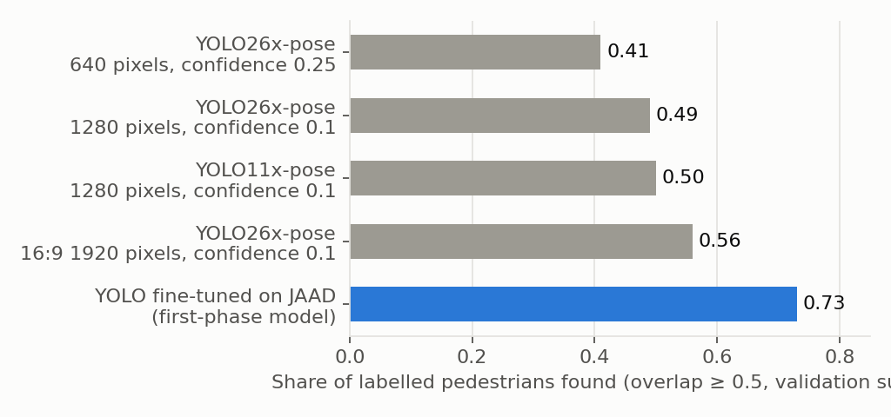
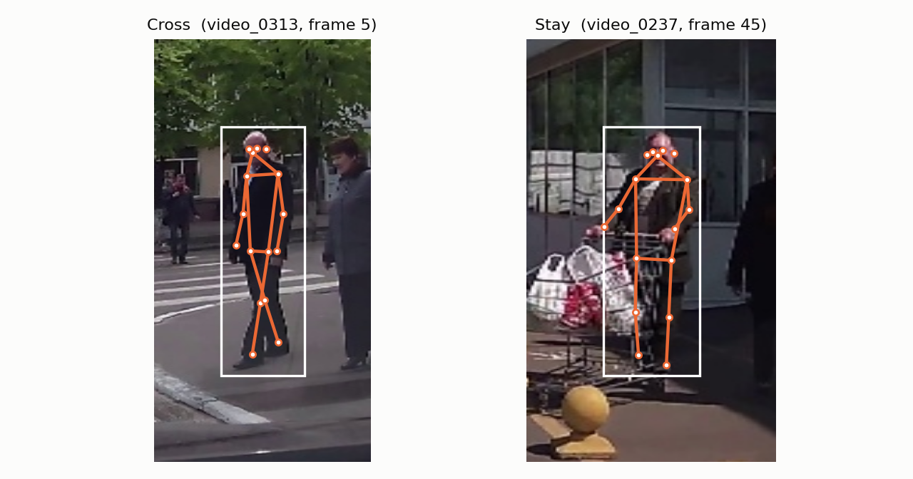
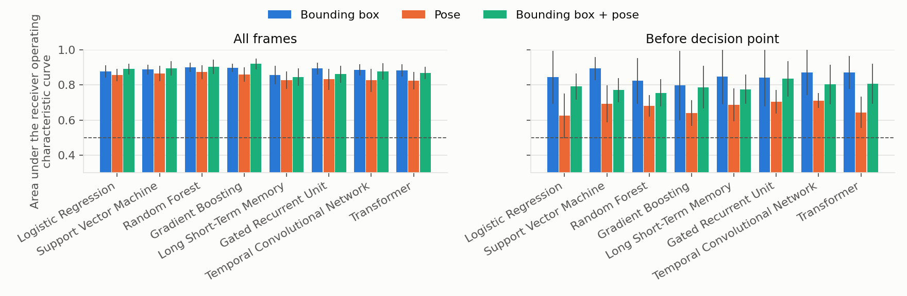

# Experiments: YOLO26 Pose and Classifier Comparison

*2026-10-05 · JAAD dataset*

## Pipeline


## Setup

| Item | Value |
|---|---|
| Pose model | YOLO26x-pose (Ultralytics 8.4), run on each cropped pedestrian found by the fine-tuned detector |
| Bounding box features | center x, center y, horizontal velocity, vertical velocity, area change, width-to-height ratio (6) |
| Pose features | 17 body keypoints (x, y, confidence) normalised to the box, plus keypoint velocity (85) |
| Window | 10 sampled frames (about 1.7 seconds) |
| Decision point | frame annotated in JAAD where the pedestrian starts acting on the decision (for example, steps toward the road) |
| Setting "All frames" | every frame of the track, including frames after the pedestrian has started crossing |
| Setting "Before decision point" | only frames up to the decision point; true early prediction, harder |
| Table columns | `<setting>: <features>`; for example, "Before decision point: bounding box" means only frames before the decision point, bounding box features only |
| Classifiers on window statistics | Logistic Regression, Support Vector Machine (after principal component analysis), Random Forest, Gradient Boosting |
| Classifiers on raw sequences | Long Short-Term Memory, Gated Recurrent Unit, Temporal Convolutional Network, Transformer |
| Training | loss weighted to balance the two classes, 3 random seeds, decision threshold tuned on the validation set |
| Metrics | area under the receiver operating characteristic curve; balanced accuracy (mean of Cross recall and Stay recall) |
| Evaluation | 5-fold cross-validation grouped by video |

## 1. Detector and pose



| Split | Labelled frames | Frames with pose found |
|---|---|---|
| Train | 15,780 | 84% |
| Validation | 3,408 | 89% |
| Test | 3,825 | 92% |



## 2. Classifier comparison: 5-fold cross-validation

Cross-validation over train + validation + test, grouped by video, 3 seeds per fold. Stay pedestrians evaluated: **74** (all frames) / **27** (before decision point).



**Area under the receiver operating characteristic curve** (best in each column in bold)

| Model | All frames: bounding box | All frames: pose | All frames: bounding box + pose | Before decision point: bounding box | Before decision point: pose | Before decision point: bounding box + pose |
|---|---|---|---|---|---|---|
| Logistic Regression | 0.877 | 0.857 | 0.890 | 0.843 | 0.624 | 0.791 |
| Support Vector Machine | 0.888 | 0.865 | 0.895 | **0.893** | 0.692 | 0.770 |
| Random Forest | **0.901** | **0.873** | 0.904 | 0.823 | 0.680 | 0.755 |
| Gradient Boosting | 0.898 | 0.859 | **0.920** | 0.796 | 0.640 | 0.786 |
| Long Short-Term Memory | 0.856 | 0.828 | 0.844 | 0.847 | 0.686 | 0.775 |
| Gated Recurrent Unit | 0.893 | 0.832 | 0.861 | 0.841 | 0.704 | **0.835** |
| Temporal Convolutional Network | 0.886 | 0.826 | 0.877 | 0.871 | **0.711** | 0.803 |
| Transformer | 0.883 | 0.824 | 0.868 | 0.871 | 0.643 | 0.807 |

**Balanced accuracy**

| Model | All frames: bounding box | All frames: pose | All frames: bounding box + pose | Before decision point: bounding box | Before decision point: pose | Before decision point: bounding box + pose |
|---|---|---|---|---|---|---|
| Logistic Regression | 0.798 | **0.787** | 0.800 | 0.705 | 0.518 | 0.657 |
| Support Vector Machine | 0.812 | 0.764 | 0.790 | 0.747 | 0.582 | 0.606 |
| Random Forest | 0.813 | 0.784 | 0.814 | 0.702 | 0.579 | 0.640 |
| Gradient Boosting | **0.814** | 0.763 | **0.823** | 0.707 | 0.578 | 0.713 |
| Long Short-Term Memory | 0.777 | 0.721 | 0.739 | 0.685 | 0.604 | 0.704 |
| Gated Recurrent Unit | 0.794 | 0.739 | 0.756 | 0.756 | 0.624 | **0.736** |
| Temporal Convolutional Network | 0.783 | 0.720 | 0.764 | **0.778** | **0.625** | 0.731 |
| Transformer | 0.793 | 0.732 | 0.754 | 0.763 | 0.562 | 0.723 |

**Summary**

| Setting | Bounding box | Pose | Bounding box + pose |
|---|---|---|---|
| All frames: best area under curve | 0.901 (Random Forest) | 0.873 (Random Forest) | **0.920** (Gradient Boosting) |
| All frames: best balanced accuracy | 0.814 (Gradient Boosting) | 0.787 (Logistic Regression) | **0.823** (Gradient Boosting) |
| Before decision point: best area under curve | **0.893** (Support Vector Machine) | 0.711 (Temporal Convolutional Network) | 0.835 (Gated Recurrent Unit) |
| Before decision point: best balanced accuracy | **0.778** (Temporal Convolutional Network) | 0.625 (Temporal Convolutional Network) | 0.736 (Gated Recurrent Unit) |

| Finding | |
|---|---|
| All frames | Adding pose to the bounding box gives a small gain (+0.02 area under curve) |
| Before decision point | Adding pose hurts all 8 models; the bounding box alone is best |
| Pose alone | Worse than the bounding box in every setting |
| Model family | No clear winner; tree and support vector models are as good as sequence models |

## Next

- [ ] Fewer pose features (principal component analysis, head orientation, a few joint angles) to limit overfitting before the decision point
- [ ] Add the PIE dataset for more training data
- [ ] Performance as a function of time before the decision point

## Reproduce

```bash
python pose_extract.py              # keypoints -> outputs_pose/pose_*.pkl
python exp_classifiers.py --cv      # cross-validation -> outputs_pose/results_cv.csv
python make_figures.py              # -> docs/figs/, docs/tables.md
```
